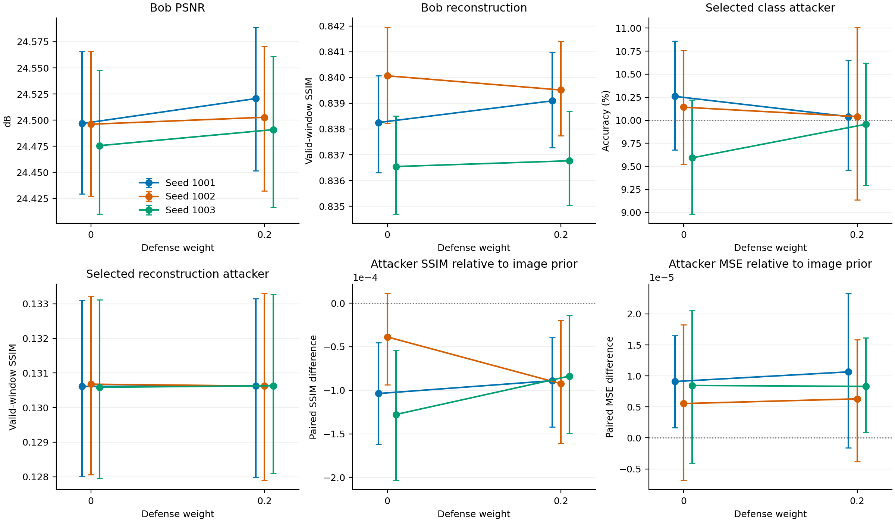

# Keyed Orthonormal Deep JSCC

Python implementation and numerical analysis for **Privacy-Preserving Deep JSCC for Wireless Image Transmission Using Keyed Orthonormal Latent Scrambling**, by Hossein Ahmadi, Fatemeh Hashemi, Amirhossein Ahmadi and Ali Kuhestani.

The project studies deep joint source–channel coding (JSCC) for wireless image transmission. A shared key and a public packet nonce select an energy-preserving transformation of a learned image representation. The intended receiver inverts the transformation before decoding. The experiments evaluate image reconstruction, class inference, transform reuse, invariant-aware attacks and transmission-resource accounting over additive white Gaussian noise channels.

## Start here

Open the repository in PyCharm with a Python 3.12 virtual environment, then run:

```bash
python -m pip install -e ".[dev]"
python scripts/reproduce_analysis.py
python -m pytest
```

The analysis reads bundled numerical inputs and produces tables and grid figures on the CPU. Model training and dataset downloads are separate commands. See [PyCharm setup](docs/PYCHARM.md) for Windows, macOS and Linux instructions.

## Reproduce the numerical analysis

```bash
python scripts/reproduce_analysis.py
```

The recorded inputs include per-image outcomes for six independently trained codecs, attacker selection and convergence records, repeated key/channel evaluations, header-resource measurements, SSIM comparisons and Kodak outcomes. The analysis recomputes reconstruction metrics, paired comparisons and uncertainty intervals, then writes CSV tables and PNG/SVG figures under `results/generated/`.

The six-codec study pairs training seeds 1001, 1002 and 1003 at semantic-defense weights 0 and 0.2. Each selected codec is evaluated over three keys and three independent channel-noise draws on 3600 held-out CIFAR-10 images. Intended-receiver and eavesdropper payload signal-to-noise ratios (SNRs) are 12 and 20 dB, respectively. Peak signal-to-noise ratio (PSNR) is calculated from pooled mean squared error; structural similarity (SSIM) uses valid image windows for the principal comparison.

See [result fields and averaging](docs/RESULT_SCHEMA.md) and [experiment commands](docs/EXPERIMENTS.md).



## Train the codecs and attackers

Install PyTorch and the training dependencies as described in [GPU setup](docs/GPU_SETUP.md). On a CUDA-capable PC:

```bash
python scripts/hardware_check.py
python scripts/run_experiments.py --device cuda --config configs/experiment.json
```

The runner downloads and verifies the official CIFAR-10 Python archive, trains the paired codecs, fits reconstruction and classification attackers, selects their checkpoints using validation data and evaluates the held-out images. Checkpoints and numerical outputs are saved under `outputs/experiment/`. Repeating the same command resumes compatible saved work.

A small synthetic execution checks the training pipeline:

```bash
python scripts/run_experiments.py --device cpu --smoke
```

The synthetic run checks execution; the recorded scientific results come from the complete experiment configuration. Training and evaluation stages can also be selected with `--stage train` and `--stage attacks`.

## Project structure

```text
configs/                 Experiment settings
data/                    Recorded numerical analysis inputs
docs/                    Setup, experiment commands and result schema
experiments/             Complementary codec, attack and channel evaluations
results/generated/       Recomputed numerical tables and figures
scripts/                 Analysis, training and hardware entry points
src/keyed_jscc/           Protocol, models, fitting, metrics and analysis
tests/                   Numerical and protocol tests
```

## Data and software citation

[CIFAR-10](https://www.cs.toronto.edu/~kriz/cifar.html) and [Kodak](https://r0k.us/graphics/kodak/) remain available from their original providers. Numerical experiment outcomes are included in `data/`; the original images are obtained from those providers. Trained weights and latent archives are available from the corresponding author upon reasonable request.

Software citation metadata are provided in [CITATION.cff](CITATION.cff). The implementation is distributed under the [MIT License](LICENSE).
